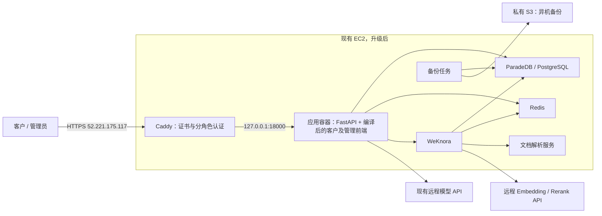

# AWS 单机完整部署方案

日期：2026-10-13。状态：设计完成，尚未实施。按用户最新要求：1–5 人同时使用；迁知识库和业务参考数据，历史会话与管理记录留本机。

## 1. 结论

复用现有 EC2、公网 IP 和 Caddy，将 EC2 升至 t3.medium（2 vCPU、4 GiB），加密 gp3 根盘从 8 GiB 扩至 60 GiB。Caddy 继续处理 HTTPS、viewer/admin 认证，直接访问同机容器中的应用。前端打包进后端镜像，不再依赖 Vite 或本机 SSH 隧道。

Nginx 本身很轻，但已有 Caddy 承担相同职责，不需要再增加 Nginx。首期不增加负载均衡器、第二台应用服务器、Kubernetes、NAT Gateway、RDS 或 Langfuse。保留现有数据库和知识服务以减少功能迁移风险。

4 GiB 是待验收的起始容量，不是性能保证。本机容器当前合计约 1.31 GiB（单次快照，非峰值）；实际部署包含操作系统、缓存、图片处理和解析峰值。若 5 人验收出现内存不足或持续超过 80%，升至 8 GiB；若瓶颈是模型供应商限流，加内存不能解决。

S3 是对象存储，存备份，不进入在线请求链路。上述服务全部在 AWS 运行后，本机关机不会影响网站；单台 EC2 仍是故障点，本方案不承诺高可用。

## 2. 现状与需要补齐的部分

| 项目 | 已有能力 | 本次需要处理 |
| --- | --- | --- |
| 前后端镜像 | Dockerfile 已构建客户与 admin 两个入口并由 FastAPI 托管 | 构建 Linux amd64 发布镜像；验证实际镜像而非本机 Vite |
| 公网入口 | Caddy、正式 IP 证书、独立 viewer/admin | 保留认证逻辑，将上游从 15173 改至 18000 |
| 数据库 | PG17 + pg_search 0.22.2 + vector 0.8.1 | 同版本新建两个空库；不恢复本机 haike 全库 |
| 知识库 | 官方 Q&A 可重建 | 云端新 tenant、API key 和知识库；重新生成云端 manifest |
| 生产 Compose | 旧覆盖使用 Nginx 并自动 build | 新增 AWS 专用覆盖，仅应用端口绑定回环；不启动旧 proxy |
| 初始化 CLI | seed 与知识入库逻辑可复用 | 适配云端 env/manifest 路径及一次性写入权限 |
| 发布与回滚 | 有 release、release-check、rollback | 云端统一指定 compose/env；镜像 digest 与 config 成对切换 |
| 备份 | 每日两库逻辑备份、保留 7 天 | 加文件/manifest/配置备份及异机副本；严格恢复验收 |

### 不直接照搬旧部署命令的原因

- `make prod-up` 会启动 Nginx 占用 80/443，与当前 Caddy 冲突；旧 Nginx 没有当前 admin 独立权限语义。
- `make db-upgrade`、`db-check` 默认在宿主机读取项目 `.env`，需提供云端容器内执行入口。
- `knowledge/cli.py` 目前向 `REPO_ROOT/.env` 写 key、向 `REPO_ROOT/data/knowledge` 写 manifest；在容器中这些路径可能落到 `/`。应显式支持 `/etc/haike/haike.env` 与受控数据目录。
- 当前 `restore.sh` 会在 `pg_restore` 出错后继续；这不符合恢复验收要求。改为严格判断错误，恢复到隔离新库验证，不能只看 “restore done”。
- `scripts/rollback.sh` 只换 config 并重启默认 Compose，不会自动切镜像，也未使用云端 env。实施时需适配，不能直接宣称已具备完整云端回滚。

## 3. 最小运行配置

- 同一台 Ubuntu 24.04 x86_64 EC2，保留 `52.221.175.117`、现有 Caddy 2.11.7 和证书存储目录。
- 宿主机只允许公网 TCP 80/443；SSH 22 仍仅允许运维出口 `/32`。数据库、Redis、WeKnora、文档解析不发布宿主机端口。
- 应用容器只发布 `127.0.0.1:18000:8000`。Caddy 直接连回环地址，不需要 AWS 内网跨机通信或额外代理。
- `APP_ENV=prod`，保持已冻结的 `MODEL_LANE`，正式服务启用真实模型/知识库，`REPLAY_CASE_ID` 为空；演练配置与正式配置明确区分。
- 一个应用 worker，先沿用当前有状态运行方式，不为 5 人使用增加多副本。模型限流与等待策略按实际 5 人测试调整。
- 所有模型、DB、Redis、WeKnora 凭据只在 `/etc/haike/haike.env`，权限 600；保留现有 Caddy 认证字段，不覆盖原文件丢失访问账号。禁止启动参数输出环境变量。
- 云端两个数据库是新建的，因此 DB/Redis/WeKnora JWT/AES/tenant 凭据生成独立新值，重新登记模型。旧模型 key 可受控配置到云端，值不写入发布包。
- `config` 和官方参考数据绑定发布版本；manifest 指向云端 KB ID，初始化阶段可写、应用运行阶段只读。不能把本机 manifest 原样当云端 manifest。
- Docker 和 Caddy 开机启动，容器 `restart: unless-stopped`；设置日志轮转、磁盘与内存告警。应用 `/health/live` 是存活检查，依赖健康另外检查。
- T3 保持 Standard 模式，并观察 CPU 积分。积分耗尽可能限制 CPU，因此容量测试和上线观察必须记录积分趋势；持续高 CPU 时再评估实例类型或 Unlimited 费用。
- 4 GiB 起步不在业务服务器上构建镜像；使用 CI 或明确 Linux amd64 的构建环境。保留当前版和上一版镜像即可，不搬本机全部 Docker 镜像缓存。

现有 Caddy 对 admin 路径认证后覆盖 `X-Authenticated-User`，普通路径删除该头，并移除 Basic Authorization，迁移后保持此语义。代理上传上限与应用的 5 MB 图片限制配合验证。公开入口维持原 URL：`/` 与 `/admin/`。

## 4. 数据范围

| 数据 | 云端处理 | 验证方式 |
| --- | --- | --- |
| `config/` | 发布版本快照 | 文件摘要、配置版本与镜像一致 |
| `data/official/` | 随发布镜像迁入，包含订单、经销商、Q&A 等参考数据 | 源文件摘要和业务样例查询一致 |
| 产品目录 | 空库迁移后运行 `seed products` | 源版本、业务主键集合一致；当前源库 8 条仅为盘点值 |
| Q&A 知识内容 | 云端新建知识库重新入库、生成向量及搜索索引 | 可见 qa_id 集合、正文摘要、元数据、解析状态与检索样例 |
| 额外手工知识 | 冻结前先核对；如不在官方源中，单独导出内容与必要文件后导入 | 不能因为重建官方 Q&A 而遗漏 |
| 本机 haike 的会话、图片、checkpoint、管理事实/操作记录 | 不导入云端 | 云端开放前业务历史表为空，验收数据单独标识 |
| WeKnora 聊天与消息 | 不导入云端 | 云端 sessions/messages 无源历史；不整库复制 |
| Redis 的临时状态、旧日志、旧评测产物 | 云端新建，不作为业务参考数据迁入 | 新环境无旧任务或旧会话 |

当前源库约 haike 1.93 GiB、WeKnora 40.2 MiB；WeKnora 有 1,514 条知识记录以及 4 条会话、20 条消息。这些是总表盘点值，包含范围需核对，不能直接把 1,514 当有效知识条目验收值。

采用“内容重建”避免携带历史与旧环境凭据，会发生一次知识向量生成费用；按冻结内容计量，并记录模型和维度（当前约定 1024）。完成后必须核对源外手工条目、解析失败和等待状态。现有 `kb-verify` 即使打印失败也可能返回 0，需补严格检查。

本机历史保留不会自动阻止现有 TTL 清理。迁移前为本机历史生成只读归档，记录恢复方法；不在本轮改变其他会话正在使用的开发服务或清理策略。

## 5. 实施顺序与切换

1. **冻结发布物**：确定 Git SHA；当前工作区仍有其他会话修改，不直接打包漂移目录。按仓库要求跑发布检查和 CI，使用 `make release` 生成清单，不手写生成文件。记录镜像 digest、config/官方数据摘要、迁移 head 和知识源版本。
2. **补齐部署入口**：新增 AWS Compose/Makefile 入口、云端初始化路径、严格健康/知识/备份验证和成对回滚。先用假模型、假知识库和隔离数据验证配置与认证。
3. **保留恢复点**：归档现有 Caddy 配置、证书存储及实例信息，保留加密根盘快照；归档本机历史。记录当前可用隧道和云端入口。
4. **升级现有实例**：安排短维护窗口，停 EC2、调整 t3.medium、扩容 EBS 并核对文件系统实际容量、再启动。需要短时网站不可用，不能承诺零停机。验证 EIP、证书、Caddy 和旧隧道重新可用。
5. **启动云端依赖**：创建新数据卷与云端 env，启动 PG/Redis/WeKnora/docreader，应用暂不接公网。执行空库迁移和产品 seed，重建知识库并等待全部解析成功。初始化必须明确指向云端，避免误操作本机。
6. **切换前验收**：应用监听 18000；通过运维 SSH 本地转发访问，只在回环测试端口加载拟上线 Caddy 配置验证认证。旧 15173 继续服务公网，避免提前接收真实业务。
7. **短维护切换**：阻止新会话/写入并让当前流式请求结束，超时请求明确提示重试；暂停知识内容变更。验证 Caddy 新配置后 reload，将上游改为 18000。旧会话不迁移，客户端已有会话若在新库找不到，明确提示“开始云端新会话”，不能静默卡住或串用 ID。
8. **独立运行验收**：通过后卸载本机隧道 LaunchAgent，确认 15173 无监听；本机断网/关机后由手机蜂窝网络或另一台设备完成客户与 admin 验收。再执行一次云服务器重启恢复验证。
9. **交付**：记录版本、链接、数据范围、备份位置、恢复耗时、验收结果和费用。保留观察期 24–48 小时的记录，之后再决定是否清理旧隧道脚本；本机历史不删除。

本轮没有执行上述变更。停机时长由实施预演确定；内容重建在旧入口正常服务时进行，不计入必须停写的切换窗口。

## 6. 验证与通过条件

以下为计划门槛，当前均未在云端完成验证。每项记录时间、release ID、预期/实际结果及脱敏证据，不能用一张页面截图替代业务验收。

| 层次 | 方法 | 通过条件 |
| --- | --- | --- |
| 发布物 | 镜像架构/digest、配置/官方数据摘要、release-check、数据库迁移检查 | Linux amd64；镜像、配置、迁移和知识内容属于同一发布 |
| 依赖 | `/health/live`、`/health?force=true`、数据库及 Redis/WeKnora 检查 | 不只检查 HTTP 200；必需组件状态均 ok，知识适配器已加载 |
| 数据范围 | 对照参考数据与知识内容，检查云端业务历史 | 参考数据一致；无本机历史会话；所有知识解析成功且无遗漏 |
| 网络与 TLS | 公网证书校验、端口检查 | HTTPS 不跳过校验；只有 80/443 公网可用，22 限制来源，其余服务不暴露 |
| 访问权限 | 无凭据、viewer、admin；编码路径及伪造身份头 | 未认证 401；viewer 管理页/API 401；admin 正常；客户端无法伪造管理员 |
| 前端 | 实际生产页面、admin 深链刷新、静态文件与控制台 | 页面/资源正常，无开发模块/HMR 请求、无 localhost API 请求、无浏览器错误 |
| 基础业务 | 新会话→选产品→多轮排障→反馈；订单参考查询；admin 查新会话 | 结果符合冻结样例；会话状态、操作、管理数据一致 |
| 模型与检索 | 从 AWS 发限定数量真实文本/视觉、Embedding/Rerank 样例 | 确实访问厂商，召回正确知识与来源；不把无知识降级或回放当真实通过 |
| 图片与流式输出 | 合法/超限图片；POST SSE 持续超过 60 秒；断网重连 | 超限明确拒绝；事件逐步到达、不被缓冲；重连不重复执行动作 |
| 5 人容量 | 隔离环境 5 会话持续 30 分钟假模型压测；正式云端限定 5 会话真实混合冒烟 | 无 OOM/异常重启；基础链路成功率 ≥99%；业务冒烟全部符合预期 |
| 重启恢复 | 在隔离数据演练应用重启；正式维护窗口 EC2 重启 | 5 分钟内恢复依赖就绪；会话快照与知识持久化，打断的 run 有明确恢复状态 |
| 备份恢复 | 从异机备份恢复到隔离新库/新卷 | 校验数据、manifest、关键会话和检索；记录实际恢复耗时，任何导入错误均处理 |
| 本机独立性 | 卸载隧道并确认 15173 消失，再本机断网/关机，外部设备访问 | 新对话、图片、知识检索、admin 可用；云端日志能对应这些请求 |

### 容量与延迟口径

“5 人同时在线”和“5 人同时发起模型调用”分别记录，至少演练一次同时提交。30 分钟压力阶段使用假模型，不持续消费真实模型 token；另用限定样本验证实际厂商并发和速率限制，两种结果不能混用。

建议初始验收目标：非模型 API 的 P95（95% 请求不超过的耗时）小于 1 秒；云端真实文字首个可见内容 P95 不高于同版本基线 1.3 倍，并优先争取 10 秒以内；图片独立记录。基线不足时先采样，不把目标写成已达标。模型 429、超时、降级次数单独列出，不能被总成功率掩盖。

持续监测总内存、磁盘、CPU 积分、数据库连接和模型门限。默认 `max_in_flight=50` 不代表可以承载 50 个用户。若资源充足但慢在厂商网络/限流，应调整调用调度与路由，而非先增加机器。

## 7. 备份与回退边界

每日两库逻辑备份，连同 WeKnora 文件、云端 manifest、配置和发布标识保存，保留至少 7 天，并上传私有加密 S3；使用 EC2 IAM role，不配置长期 AWS access key。数据与配置备份不包含可明文传播的密钥；密钥恢复从受控 env/加密恢复点处理。

建议恢复目标：最多损失 24 小时新业务数据，恢复时间目标 60 分钟，均需用恢复演练确认。对更严格的数据恢复目标另行设计；只有同机 pg-backups 卷不能应对整机/磁盘丢失。

- **切换前失败**：保留公网旧上游，修复云端，不影响本机业务历史。
- **切换后、尚无正式云端写入**：可以把 Caddy 上游切回仍有效的本机隧道；同样需要用户按仓库规则确认回退操作。
- **已经产生云端新会话**：云端数据库成为这些数据的唯一权威。先停写并备份，优先把云端镜像/config 成对回退，保留云端数据库；不能直接切回本机旧库，否则新会话不可见且可能形成两套不一致记录。
- 首次上云没有上一版云端镜像时，保留可演练的发布物；不能假定任意旧版本与新库兼容。数据库迁移只前向，回退兼容性必须验证。
- 将 EBS 从 8 扩至 60 GiB 后不能当作可原地缩回；即便回退应用，磁盘计费仍按扩容后容量。

## 8. 费用与实施边界

单机升级后的整月基础费用估算，按新加坡、Linux、730 小时：

| 项目 | 估算 |
| --- | ---: |
| t3.medium：0.0528 USD/h（2026-10-13 官方价目核对） | 38.54 USD/月 |
| 一个公网 IPv4：0.005 USD/h（官方页面核对） | 3.65 USD/月 |
| 60 GiB gp3：按 2026-10-10 已核实的 0.096 USD/GiB/月估算，实施前复核 | 5.76 USD/月 |
| 合计 | 约 48 USD/月 |

这是替代原约 14 USD/月入口规格后的总基础费用，不是再加一台服务器；增量约 34 USD/月。不含税费、额外公网流量、S3/快照、真实模型及知识向量生成。T3 Standard 不计 Unlimited 超额积分费，但可能受 CPU 基线限制。

2026-10-10 曾查到 200 USD 额度、2026-10-31 到期，本轮未重查账户余额，不能保证当前余额或后续抵扣。模型服务费也不能视为 AWS 额度自动覆盖。

用户本轮要求规划和设计，尚未批准新的规格费用及维护窗口。本轮已完成只读盘点与设计；实施前应确认这份具体方案和停机窗口，再执行资源升级、构建发布、初始化及限定真实模型验收。

## 9. 依据

- 仓库：`docker-compose.yml`、`orchestrator/Dockerfile`、`deploy/tunnel/Caddyfile`、`Makefile`、`docs/runbook/{deploy-prod,release,database}.md`。
- 实现核对：`app/main.py`、`app/settings.py`、`app/health/`、`app/knowledge/{cli,ingest,runtime}.py`、`app/seed_cli.py`、`deploy/backup/restore.sh`。
- [AWS T3 规格与积分模式](https://aws.amazon.com/ec2/instance-types/t3/)。
- [AWS 新加坡 Linux 公开价目](https://b0.p.awsstatic.com/pricing/2.0/meteredUnitMaps/ec2/USD/current/ec2-ondemand-without-sec-sel/Asia%20Pacific%20(Singapore)/Linux/index.json)。
- [AWS 公网 IPv4 价格](https://aws.amazon.com/vpc/pricing/)、[EBS 价格](https://aws.amazon.com/ebs/pricing/)。
- [EC2 规格变更](https://docs.aws.amazon.com/AWSEC2/latest/UserGuide/ec2-instance-resize.html)。
- [PostgreSQL 17 逻辑备份](https://www.postgresql.org/docs/17/app-pgdump.html)。
- [EC2 IAM role](https://docs.aws.amazon.com/IAM/latest/UserGuide/id_roles_use_switch-role-ec2.html)。
