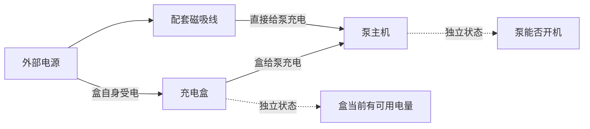

# T52最小诊断图谱：搭建方法与试验结论

已做出可运行的独立原型。它能在事实对象正确的前提下，拦住T52的“盒自身充不进电→泵不开机→泵复位”错误选路，同时保留有依据的跨部件操作。原型没有接入生产会话，也没有证明充电盒实际被修复。

关键结论：图谱适合把选路依据变成可检查的数据，但不能自动证明上游模型的语义抽取正确。下一阶段值得继续做；不应把本次通过率当成可以直接全量上线的依据。

## 图谱实际上是什么

本次图谱是一个小型的“对象、关系、适用条件和出处”文件。用YAML存储、Python读取即可，没有引入Neo4j或其他图数据库。

图谱分两层，两层数据不能混在一起：

| 层 | 内容 | 谁提供 |
| --- | --- | --- |
| 产品知识图 | 电源、盒、磁吸线、泵之间有哪些关系；一个操作适合什么故障分支、需要什么条件 | 已核对的主办方官方资料及本次代理审核的工程标注 |
| 会话事实图 | 用户这次说哪个能力失败、哪项正常、什么是后果、哪些旧事实已被纠正 | 用户原话，经模型抽取并保留轮次和逐字出处 |

产品关系不携带本次用户的故障结论。会话中的“盒坏了导致泵充不了”也不能反过来成为适用于所有用户的产品定律。



本轮包含4个部件节点、6项关系或能力、9段来源引文、6个候选。它是为T52做的小型关系模型，没有加入泛化图推理或自动物理故障传播。

## 怎样一步步搭建

**第一步：从资料提取关系。**

核对bp-0066盒充电说明、bp-0049两种充电方式、bp-0067盒需有可用电量、bp-0039盒给泵充电排障、bp-0114泵不开机分支。每条图关系和操作绑定文档ID与原文片段；加载时检查该片段确实存在，且资料适用于T8D04。

这一步的重点不是“找到包含充电盒的文章”，而是分清它说的是哪一条关系。没有手改生成的qa.yaml，也没有凭常识创造盒复位步骤。

**第二步：把操作连到适用分支。**

同样是复位泵，bp-0114用于泵不开机，bp-0039也把它用于盒给泵充电异常。所以操作必须带“所属分支＋目标关系＋必要条件＋来源”。不能只建一条“泵复位”节点，然后全局允许或禁止。

例如，接触检查的原型数据是：

```yaml
id: contacts
plan_id: qa_bp_0039
targets: [case_output]             # 当前要查盒给泵充电
requires:
  case_output: failed             # 用户明确报告此路径异常
  case_power: works               # 盒当前有电
purpose: diagnose
sources: [contact, case_energy]
```

这里把“盒有电”设为保守入口条件，是本次工程标注，不冒称厂家原文规定的唯一顺序。实际执行还要满足步骤顺序和资源条件，原型只评估适用性。

**第三步：从原话建立本次事实图。**

T52的真实抽取三次均得到：

- 主诉：盒自身受电失败；出处是“My charging case will not charge”。
- 后果：无法通过盒给泵充电；出处是“therefore I cannot charge my pump motors”。
- 因果边：用户说前者导致后者；不等于系统已查明物理根因。
- 泵能否开机、盒里是否还有电：没有依据，不补成故障或正常。

事实保留原文、轮号、角色、状态及是否仍有效。用户明确纠正时保留旧事实并标记失效，当前目标随有效事实重新计算。本轮只是对完整输入重新计算，没有接入生产增量状态或旧卡片失效机制。

**第四步：按事实图检查候选。**

判定次序是：型号与出处有效 → 事实无未解决矛盾 → 主诉明确 → 操作有已核对来源 → 目标关系匹配 → 条件满足。候选置信度不用于覆盖这些约束。

结果分别为：适用、拦截、待确认、仅临时办法、无需重做、缺来源需审核。错误候选不会因为“有官方引用”就得到执行资格。

**第五步：按用途解释结果。**

对T52，泵不开机分支被拦截；没有受电故障修复知识时明确资料缺口。如果用户有配套磁吸线，可说明直充属于临时供电办法。直充正常后仍保留盒故障，不把它当成解决。

## 试验结果

| 检查 | 结果 | 能说明什么 |
| --- | --- | --- |
| 人工标注12个场景 | 规定目标与候选判定12/12符合预期 | 图规则能表达这些边界 |
| 真实模型14次抽取 | 规定目标与候选判定14/14符合预期 | 这批原文经模型抽取后可以接入规则；不是线上正确率 |
| T52原文重复3次 | 主目标均为盒自身受电，均拦泵不开机分支 | 本次重复中保持了主诉与后果关系 |
| 0.95置信度错误候选注入 | 当前生产过滤函数放行，图谱拦截 | 当模型选路错误、事实抽取正确时有独立约束 |
| 盒满电但泵在盒内不充 | 相关接触、复位和交叉检查判为适用 | 没有一刀切禁止操作泵 |
| 引文造假 | 暂停自动批准 | 出处存在性校验有效 |
| 真实引文配错误关系标签 | 仍放行错误泵复位 | 图谱不能独立保证语义归类正确，残余问题明确存在 |

模型是deepseek/deepseek-v4-pro，按现有intake路由调用；未给它人工标注或预期答案。完整输入、事实和候选结果见[中文验证记录](中文验证记录.md)。

人工复核发现1项额外问题：泵不开机场景中的“充电盒正常”被模型抽成了更具体的“盒给泵充电正常”。本次没有影响主目标，但不应据此声称全部事实都准确。

运行检查：`make lint`通过；HTML解析和内嵌JavaScript语法检查通过。本轮按原型流程执行场景评估，没有新增pytest测试文件、跑全量CI或构建Docker。浏览器工具因不允许file协议拒绝本地页面打开，未绕过限制，未完成浏览器点击验收；单文件可由用户本机打开。

## 文件和复现入口

原型位于`orchestrator/app/diagnose/`，名称均带`prototype_t52`，不被生产路由引用：

- `prototype_t52_graph.yaml`：部件、关系、来源和操作条件。
- `prototype_t52_graph.py`：严格模型、来源校验和适用性判定。
- `prototype_t52_cases.yaml`：12组人工标注及预期，仅用于对照评估。
- `prototype_t52_runner.py`：真实抽取、故障注入、结果保存和演示生成。
- `prototype_t52_demo.html`：单文件演示模板，显示已评估快照及场景切换。

```bash
make t52-graph-prototype
make t52-graph-prototype LIVE=1
make t52-graph-prototype REUSE=1
```

第一条仅评估人工标注，不调用模型；第二条进行14次真实模型抽取；第三条复用已保存抽取、重新执行当前规则。输出在`reports/eval/t52-graph-prototype/`，其中`T52诊断图谱演示.html`可双击打开，不需要安装依赖或图数据库。原始JSON和生成演示按项目约定留本机，源码及结论文档可入库；当前未提交。

演示里的“没解决”只展示不增加新故障事实的设计，不等于已验证生产反馈路由。图谱通过的候选也不等于可以立即发卡：备件可用、前序步骤、禁忌、执行后观察等还需生产流程处理。

## 下一步怎样接入，才值得继续试

建议先做影子评估：原生产路由照常选择候选，图谱同时记录是否批准及原因，先不改变真实客户操作。重点补齐三件事：

1. **抽取质量。** 建立对象、关系、否定、侧别、因果与修正的单独评测；“用户原话存在”不等于“标签语义正确”。不明确时保留未知，需要时请用户确认具体目标。
2. **执行边界。** 将图谱检查接到选分支和发卡前；客户纠正目标后旧批准失效。顺序、备件和临时办法分别表示，不能只凭单条适用判定直接执行。
3. **资料覆盖。** 补充经过核对的盒自身受电排障知识；否则图谱只能阻止走错，无法凭空提供正确修复流程。

再联合T44、T48、T51、T53、T54、T55进行真实HTTP多轮验证，记录误放行、误拦截、过度澄清和新增延迟，之后再决定扩大图谱范围。
